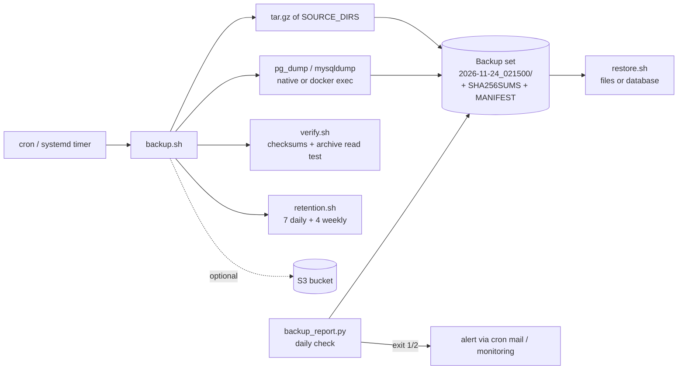

# Automated Backup & Recovery


A backup system for Linux servers built with Bash and Python. It covers:
- scheduled backups of directories and PostgreSQL/MySQL databases
- checksum verification of every backup set
- daily and weekly retention
- an optional off-site copy to S3
- a tested restore path
- a monitoring script that alerts when backups are stale or broken

> Portfolio project. CI runs every script against real files and a real PostgreSQL container, so the restore path is tested, not assumed.

## Architecture



## Features

| Requirement | Implementation |
|---|---|
| Automated backups | `backup.sh`: directory archives plus PostgreSQL and MySQL dumps, with a `flock` so two runs can't overlap |
| Scheduled execution | `cron/backup.cron` (daily at 02:15) |
| Backup verification | `verify.sh` checks the SHA-256 checksums, reads every tar archive and runs `gzip -t` on the dumps. It runs after every backup. |
| Recovery scripts | `restore.sh`: list sets, restore files to any directory (with `--dry-run`), or restore a database. It refuses to restore a set that fails verification. |
| Logging | Every action is timestamped in `/var/log/backup.log` |
| Retention policies | `retention.sh` keeps the newest N daily sets plus N Sunday sets as weekly |
| Monitoring | `backup_report.py` exits non-zero if the newest backup is too old (code 1) or corrupt (code 2). It also has JSON output. |
| Off-site copy | `aws s3 sync` when `S3_BUCKET` is set |
| Safety | A failed backup removes its partial set, so a half-written backup is never kept |

## Quick start

```bash
git clone https://github.com/AmanMasood/automated-backup-recovery.git
cd automated-backup-recovery
cp config/backup.conf.example config/backup.conf   # set SOURCE_DIRS, BACKUP_ROOT, DB settings

./scripts/backup.sh                      # create + verify + prune
./scripts/restore.sh --list
./scripts/restore.sh latest --target /tmp/restore --dry-run
python3 scripts/backup_report.py --max-age-hours 26
```

Install on a server:

```bash
sudo mkdir -p /opt/backup && sudo cp -r scripts /opt/backup/
sudo cp config/backup.conf.example /etc/backup.conf     # edit
sudo cp cron/backup.cron /etc/cron.d/app-backup
```

## Tests

| Test | What it proves |
|---|---|
| `tests/test_backup_cycle.sh` | A backup is created with a manifest. Missing directories are skipped with a warning. Verification passes, and a corrupted archive is caught. Retention keeps the right sets, including a Sunday weekly. A restore reproduces the original files byte for byte. |
| `tests/test_report.py` | Missing, stale and tampered backups each give the right exit code |
| `tests/test_postgres_roundtrip.sh` | Back up a 500-row table, drop it, restore it and check all 500 rows are back (Docker) |

```bash
bash tests/test_backup_cycle.sh
python -m pytest -q tests
bash tests/test_postgres_roundtrip.sh   # needs Docker
```

## Tech stack

Linux · Bash · Python · cron · tar/gzip · sha256sum · PostgreSQL · MySQL · Docker · AWS S3 (optional) · ShellCheck · GitHub Actions

## License

MIT
